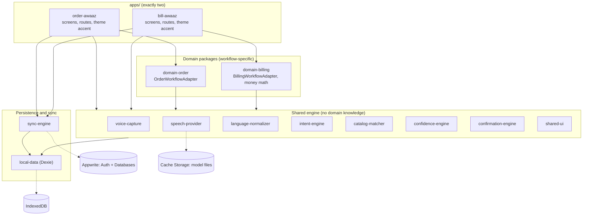
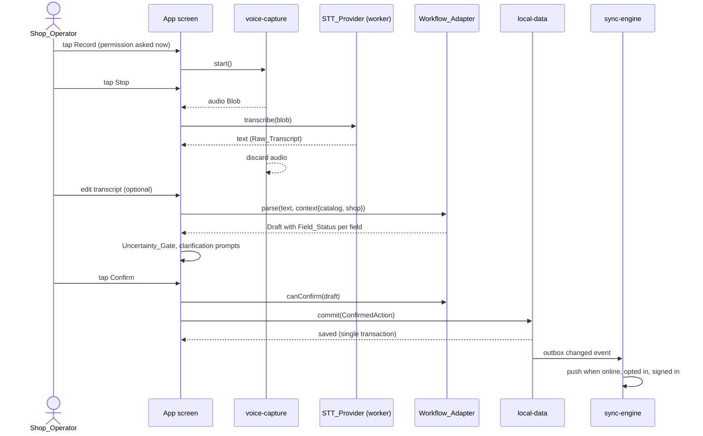
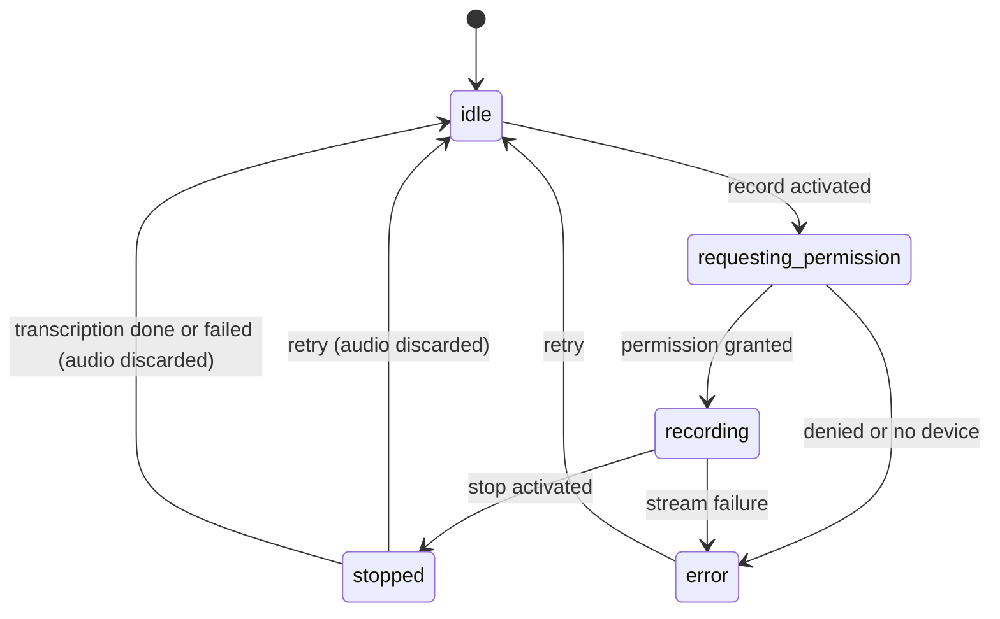
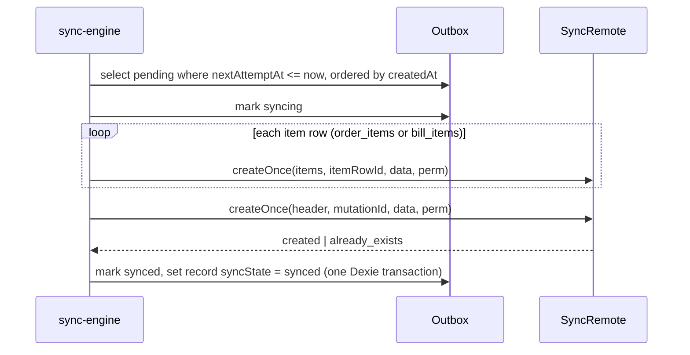

# Design Document: Awaaz Kit

## Overview

Awaaz Kit is a pnpm/TypeScript monorepo with one shared voice-workflow engine (12 packages under `packages/`) and exactly two installable PWAs (`apps/order-awaaz`, `apps/bill-awaaz`). Both apps run the same pipeline:

```
record or type -> Raw_Transcript -> Normalizer -> Intent_Engine -> Catalog_Matcher
   -> Confidence_Engine (Field_Status) -> Review_Card -> explicit confirm
   -> one Dexie transaction (records + audit event + Outbox Mutation)
   -> Sync_Engine -> Appwrite (opt-in)
```

The design optimizes for four things at once:

1. Correctness of the business loop: deterministic, pure, testable engine; no guessed fields; no write before confirmation; exact integer money.
2. Honest offline behaviour: the app shell, catalog, drafts, saved records and typed input work offline. Voice works offline only after the Speech_Model is cached.
3. A polished, judge-friendly demo (Skeleton Crew first prize): a deterministic Demo_Shop, sample utterances that work even if the microphone or model fails, a live "How it understood this" pipeline inspector, and a visible reuse proof.
4. Auditable Kiro usage: committed specs, steering, hooks and fast-check tests, with a journal of concrete issues each caught.

### Key design decisions

| Decision | Choice | Rationale |
|---|---|---|
| Engine style | Pure functions, no I/O inside parser, matcher, confidence, confirmation and domain packages | Deterministic (Req 8.3, 8.5), property-testable, reusable by a third workflow |
| Where state lives | IndexedDB (Dexie) is the source of truth; React state holds only the in-progress draft | Req 15; survives reload |
| Quantity representation | Integer milli-units (`qtyMilli`, 1.5 kg = 1500) | Removes floating-point drift in bill math (Req 14) |
| Line total rule | `round_half_up(unitPricePaise * qtyMilli / 1000)` using BigInt-safe integer arithmetic | One documented rule returning an integer (Req 14.2) |
| Unit handling | No unit conversion. A unit that differs from the catalog unit becomes `needs_review` | Req 10.3 |
| Confirmation | A branded `ConfirmedAction` can only be minted by `confirmation-engine` from a user gesture; `local-data` accepts only that type | Compile-time plus runtime enforcement of Req 11.7 |
| Double-confirm | The draft id is the record id; the commit transaction is a no-op if the id exists | Req 11.8 |
| Sync transport | `SyncRemote` interface with an Appwrite implementation and an in-memory fake | Contract tests run against both; engine is testable offline |
| Remote idempotency | Create-once entities use a row ID derived from `mutationId`; duplicate create (HTTP 409) is treated as success. Products and customers use entity ID with a timestamp-guarded upsert | Req 16.3, 16.4, 16.18 |
| Transcript sync | Transcripts stay local by default after opt-in; a "Sync transcripts" setting (off by default) includes them | Req 16.19, 16.20, 18.2 |
| Hosting | Both PWAs on one origin under `/order/` and `/bill/` plus a static hub page | Same-origin IndexedDB and Cache Storage means both apps share one Catalog and one cached Speech_Model (Req 3.8) |
| Speech | `SpeechToTextProvider` with Shruti adapter, `WhisperWasmProvider` fallback, `ScriptedProvider` for tests and demo | Req 5; mitigates the largest project risk |

### Research summary

- Appwrite permissions: a resource created from a client SDK without explicit permissions grants the creator read, update and delete by default, and table-level permissions combine with row-level permissions when row security is enabled. The design therefore always passes explicit row permissions and enables row security on every synced table. Sources: [Appwrite permissions](https://appwrite.io/docs/advanced/platform/permissions), [Appwrite TablesDB rows](https://appwrite.io/docs/products/databases/tablesdb/rows).
- Appwrite offers an upsert call for rows ([announcement](https://new.appwrite.io/blog/post/announcing-database-upsert)). The design uses create-with-409-as-success for immutable entities and upsert with a timestamp guard for mutable entities, both hidden behind `SyncRemote`.
- Row IDs: Appwrite custom IDs allow up to 36 characters of `a-z A-Z 0-9 . - _` and must not start with a special character. A UUID (36 chars) satisfies this. To be re-verified against the pinned SDK in the spike (see Speech and Appwrite spikes).
- The Background Synchronization API has limited availability, so it is a progressive enhancement only (PRD section 7.4, Req 16.8).
- Shruti (browser ONNX, about 32 MB per language) and whisper.cpp WASM (tiny model about 74 MB, CPU heavy) are the PRD's candidates. Neither API surface is assumed in this design beyond the provider interface; the adapter wraps whatever the spike confirms.

Content was rephrased for compliance with licensing restrictions.

## Architecture

### Layered view



### Package dependency rules (enforced in CI)

Dependencies are acyclic and enforced by `dependency-cruiser` rules in `.dependency-cruiser.cjs`; `pnpm lint` fails on violation.

| Package | May import | Must not import |
|---|---|---|
| `voice-capture` | browser APIs only | any other package, any domain package (Req 4.9) |
| `speech-provider` | browser APIs, `onnxruntime-web` | domain packages, intent-engine, catalog-matcher |
| `language-normalizer` | nothing in the workspace | everything else |
| `intent-engine` | `language-normalizer` types | domain packages, `local-data`, network |
| `catalog-matcher` | `language-normalizer`, Fuse.js | domain packages, `local-data` (catalog is passed in as data) |
| `confidence-engine` | `intent-engine`, `catalog-matcher` types | domain packages, `local-data` |
| `confirmation-engine` | `confidence-engine` types | domain packages, `local-data` |
| `local-data` | Dexie, `confirmation-engine` types | domain packages, React, `sync-engine` |
| `sync-engine` | `local-data`, `appwrite` SDK (in one adapter file) | domain packages, React |
| `shared-ui` | React, engine packages (types), Tailwind tokens | `local-data` (UI never touches persistence, Req 15.3) |
| `domain-order`, `domain-billing` | engine packages, `local-data` record types | each other, apps |
| `apps/*` | everything above, `local-data` repositories only through hooks in the app | each other |

Rule rationale: engine packages never import `domain-*`, which is what makes the reuse claim true by construction (Req 1.5). The Workflow_Adapter lives in a domain package; the engine only knows the `WorkflowAdapter` interface.

### Deployment and hosting

```
https://<host>/            static hub page: two cards linking to /order/ and /bill/
https://<host>/order/      Order_App PWA (manifest scope /order/, own service worker)
https://<host>/bill/       Bill_App PWA (manifest scope /bill/, own service worker)
```

- The hub is a generated static `index.html` produced by `scripts/build-hub.mjs`, not an application, so `apps/` still holds exactly two folders (Req 1.2).
- Same origin means one IndexedDB database `awaaz-kit` and one Cache Storage namespace for the Speech_Model. Download once, use in both apps.
- During `pnpm dev:order` and `pnpm dev:bill` the apps run on different ports and therefore different origins, so each seeds its own Demo_Shop. This is documented in the README; the production deployment shares data.
- Both apps ship the same `local-data` version. A Dexie `versionchange` event closes the connection and shows a "Reload to update" banner, preventing a blocked upgrade between the two apps.
- Static hosting (Cloudflare Pages) serves `index.html` fallbacks per app path. Workbox `navigateFallback` serves the app shell offline (Req 2.2).

### Runtime flow for one utterance



### Capture session state machine

`Recording_State` (Req 4.2) is a reducer inside `voice-capture`. A separate `CaptureSession` reducer in the apps (built from `shared-ui` hooks) layers transcription and parsing on top.



Transcription runs after `stopped` with its own `transcribing | ready | failed` sub-state shown as the processing indicator (Req 5.10). Typed input is a parallel entry that bypasses both machines (Req 6.1).

### Speech provider spike and fallback strategy

Risk: Hindi and Hinglish recognition quality and speed on mid-range Android are unproven (PRD risk 1 and 2). The design makes this a gated spike with a pre-agreed fallback chain, so the demo is never hostage to ASR.

Spike (Day 1, `spikes/shruti-bare-vite/`, kept in the repo as evidence in `docs/model-benchmark.md`):

| Step | Output |
|---|---|
| Load the browser model on desktop Chrome and Android Chrome via onnxruntime-web | Works or not; WASM vs WebGPU path noted |
| Download, cache and reload from Cache Storage | Cache persistence confirmed |
| Transcribe 10 Hindi, 10 Hinglish, 10 English retail clips (consented, non-identifiable, not committed as audio) | Reference vs hypothesis transcripts, word error rate per group |
| Measure first-inference and repeat-inference latency and peak memory | Table in `docs/model-benchmark.md` |

Go / no-go gate (recorded in `docs/model-benchmark.md`, decided on Nov 10):

- Go with Shruti if a 5 second clip transcribes in 10 seconds or less on the target Android phone, the model loads from cache after reload, and the transcript is editable-quality (the user can correct it in under a minute for the sample orders).
- Otherwise switch the default to `WhisperWasmProvider` (tiny model, heavier, documented caveats) if it meets the same latency bar.
- Otherwise ship typed input plus `ScriptedProvider` demo clips as the primary demo path and keep the Shruti adapter as an opt-in "experimental" provider. The product claim stays honest: voice is local and optional; typed input is first-class.

Provider selection is a one-line config in `packages/speech-provider/src/registry.ts`:

```ts
export type ProviderId = "shruti" | "whisper-wasm" | "scripted";
export function createProvider(id: ProviderId, deps: ProviderDeps): SpeechToTextProvider;
```

Inference runs in a dedicated Web Worker so the UI thread stays responsive. Recorded audio (MediaRecorder, typically WebM/Opus) is decoded with `AudioContext.decodeAudioData` and resampled to mono 16 kHz Float32 inside the adapter, so the interface remains `transcribe(audio: Blob, ...)` (PRD contract).

`ScriptedProvider` returns a fixed transcript for a known fixture clip id. It powers (a) unit and E2E tests, (b) the "Sample utterances" chips on capture screens, which fill the transcript field as if spoken. Sample chips are always labelled "Sample" in the UI so the demo does not pretend they were recognized from the microphone.

### Reuse proof design (for judges)

Reuse is demonstrated by artifacts, not just claims:

1. Import graph: `scripts/reuse-report.mjs` uses `dependency-cruiser` JSON output to write `docs/reuse-proof.md`, a table of shared packages imported by both apps. CI fails if either app lacks an import of any of the ten required capabilities (Req 1.3, 1.4).
2. Dual-parse fixture test: `tests/integration/reuse.test.ts` runs the same utterances through `OrderWorkflowAdapter` and `BillingWorkflowAdapter` and asserts both consume the same `ResolvedLine[]` from the shared pipeline (Req 1.6).
3. In-app "Powered by Awaaz Kit" panel (About screen in both apps): lists the shared packages with versions from a build-time manifest and a "Show how it understood this" toggle that opens the Pipeline Inspector (Raw, Normalized with spans, Candidates, Matches, Field_Status). The inspector is a `shared-ui` component, so both apps show the identical panel.
4. README "Build your own workflow": a 40-line `AppointmentWorkflowAdapter` example that reuses the pipeline without copying engine code (Req 1.8). A test compiles this snippet (`tests/integration/readme-example.test.ts`) so it cannot rot.

## Components and Interfaces

All contracts use TypeScript with Zod schemas at module boundaries (Req 8.10). Types below are the normative shape; file layout is under each package's `src/`.

### voice-capture

```ts
export type RecordingState =
  | "idle" | "requesting_permission" | "recording" | "stopped" | "error";

export type CaptureError =
  | { kind: "permission_denied" }
  | { kind: "no_device" }
  | { kind: "unsupported" }
  | { kind: "stream_failure"; message: string };

export interface VoiceCapture {
  readonly state: RecordingState;
  readonly elapsedMs: number;
  readonly error: CaptureError | null;
  start(): Promise<void>;        // requests permission here, never earlier (Req 4.1)
  stop(): Promise<Blob>;         // resolves with audio, state -> stopped
  retry(): void;                 // discards audio, state -> idle (Req 4.5)
  discard(): void;               // called after transcription success or failure (Req 4.8)
  subscribe(listener: (s: VoiceCaptureSnapshot) => void): () => void;
}
export function createVoiceCapture(deps?: { mediaDevices?: MediaDevices; now?: () => number }): VoiceCapture;
```

Audio is held only in a closure variable; no `IndexedDB`, `fetch` or `URL.createObjectURL` calls exist in this package (Req 4.10, 18.1).

### speech-provider

```ts
export interface SpeechToTextProvider {
  initialize(): Promise<{ ready: boolean; modelVersion?: string }>;
  transcribe(audio: Blob, options?: { language?: "hi" | "en" | "auto" }):
    Promise<{ text: string; language?: string; durationMs?: number; confidence?: number }>;
}

export type ModelStatus =
  | { kind: "not_installed"; approxBytes: number }
  | { kind: "downloading"; receivedBytes: number; totalBytes: number | null }
  | { kind: "ready"; modelVersion: string }
  | { kind: "evicted" }                       // was installed, files missing (Req 5.8)
  | { kind: "error"; message: string };

export interface ModelManager {
  status(): Promise<ModelStatus>;             // checked on app start (Req 5.7)
  download(onProgress: (s: ModelStatus) => void, signal?: AbortSignal): Promise<void>;
  remove(): Promise<void>;
}
```

- `confidence` is optional; the UI shows a numeric value only when it is present, which means only when the adapter has a calibrated source (Req 5.11, 10.9). The Shruti and Whisper adapters never populate it.
- `ModelManager` streams `fetch` with a reader for progress, verifies each file's SHA-256 against `model-manifest.json`, then stores files in Cache Storage cache `awaaz-speech-model-v1`. `status()` checks every manifest entry via `cache.match`, so eviction is detected (Req 5.8).
- Only `ModelManager.download` touches the network, and only after a user action (Req 5.5).

### language-normalizer

```ts
export interface SourceSpan { start: number; end: number }          // offsets into raw
export interface NormalizedToken {
  text: string;                  // normalized form
  kind: "number" | "unit" | "word" | "punct";
  numberValueMilli?: number;     // for kind "number"
  canonicalUnit?: CanonicalUnit; // for kind "unit"
  span: SourceSpan;              // maps back to Raw_Transcript
}
export type CanonicalUnit = "piece" | "kg" | "g" | "litre" | "ml";
export interface Normalized { raw: string; text: string; tokens: NormalizedToken[] }

export function normalize(raw: string): Normalized;
export function foldForMatching(s: string): string;   // alias-friendly token form
```

Design notes:
- `raw` is returned unchanged and never mutated (Req 7.9).
- Number words 0 to 100 are table-driven for Hindi (romanized and Devanagari), Hinglish spellings and English, with fractions `aadha`, `dedh`, `dhai`, `sava`, `paun`, half, quarter, one and a half. Values are in milli-units (`dedh` = 1500). `sava` and `paun` combine with the following number word ("sava kilo" = 1250 milli-kg, "paun kilo" = 750).
- Devanagari digits map to Latin digits. Unit tables map spellings to the five canonical units.
- Unknown tokens pass through unchanged (Req 7.6, 7.7). `foldForMatching` lowercases, strips diacritics and Latin-script spelling variants (for example `aata/atta/ata`) through a small phonetic fold table shared with alias generation.
- Idempotence (Req 7.8) is achieved by emitting canonical output forms that are fixed points of the rules: normalized numbers are rendered as ASCII digits, normalized units as canonical strings, and no rule matches its own output.

### intent-engine

```ts
export interface CandidateLine {
  index: number;                         // spoken order
  productPhrase: ExtractedField<string>;
  quantityMilli: ExtractedField<number>;
  unit: ExtractedField<CanonicalUnit>;
}
export interface ExtractionResult {
  lines: CandidateLine[];
  customerName?: ExtractedField<string>;
  customerPhone?: ExtractedField<string>;
}
export interface ExtractionContext {
  knownCustomerNames?: readonly string[];  // hints only
  locale: "hi-IN" | "en-IN";
}
export function extract(n: Normalized, ctx: ExtractionContext): ExtractionResult;
```

Extraction is a small deterministic grammar over `NormalizedToken[]`: split into item segments on separators (`aur`, `and`, `,`, `।`, `plus`), then for each segment bind `(number)? (unit)? (phrase)` in either order ("do kilo aata" and "aata do kilo" both resolve). Segments with a phrase but no number produce `quantityMilli` with `value: null` and status `missing`. Each field carries `sourceText` taken from the token spans (Req 8.7). Customer lead phrases ("Ramesh ka bill banao", "for Ramesh") populate `customerName`; a 10-digit Indian mobile pattern populates `customerPhone`. The module has no I/O and no clock/random usage (Req 8.3, 8.5).

### catalog-matcher

```ts
export interface CatalogProduct {
  id: string; shopId: string; name: string; aliases: string[];
  unit: CanonicalUnit; pricePaise: number; brand?: string;
  active: boolean; deletedAt: string | null;
}
export type MatchResult =
  | { kind: "exact"; product: CatalogProduct; via: "alias" | "name" }
  | { kind: "ambiguous"; candidates: CatalogProduct[] }       // up to 3, never auto-picked
  | { kind: "suggestions"; candidates: CatalogProduct[] }     // fuzzy, up to 3
  | { kind: "unmatched" };

export interface CatalogIndex {
  match(phrase: string): MatchResult;
}
export function buildIndex(shopId: string, products: readonly CatalogProduct[]): CatalogIndex;
```

- `buildIndex` filters to the active shop, `active === true` and `deletedAt === null` (Req 9.6, 9.7), computes `foldForMatching` for names and aliases once, and builds an exact map plus a Fuse.js index for fuzzy search.
- Exact lookup first (Req 9.1). If the folded phrase maps to exactly one product the result is `exact`. If it maps to several products it is `ambiguous` (Req 9.4). Fuzzy results within a small score margin of each other are returned as `ambiguous`, never resolved to one.
- Otherwise up to three fuzzy suggestions are returned with `unit` and `brand` for display (Req 9.3), or `unmatched` (Req 9.5).
- The matcher receives the catalog as data. It never reads `local-data`, so it stays pure and testable.

### confidence-engine

```ts
export type FieldStatus = "confirmed" | "needs_review" | "missing" | "unmatched";
export interface ExtractedField<T> {
  value: T | null; status: FieldStatus;
  sourceText?: string; confidence?: number | null; reason?: string;
}
export interface ResolvedLine {
  lineId: string;                                   // client UUID
  product: ExtractedField<{ productId: string; name: string }>;
  quantityMilli: ExtractedField<number>;
  unit: ExtractedField<CanonicalUnit>;
  candidates: CatalogProduct[];                     // for needs_review product, max 3
  spokenName: string;
}
export function resolveLines(
  extraction: ExtractionResult, index: CatalogIndex, makeId: () => string,
): ResolvedLine[];

export function applyUserValue<K extends keyof ResolvedLine>(
  line: ResolvedLine, field: K, value: NonNullable<ResolvedLine[K]> extends ExtractedField<infer V> ? V : never,
): ResolvedLine;                                    // sets status confirmed (Req 10.6)

export function nextClarification(lines: readonly ResolvedLine[]): Clarification | null;
```

Status rules (single table, one place):

| Situation | Field | Status |
|---|---|---|
| Quantity absent | `quantityMilli` | `missing`, value `null`, never defaulted to 1 (Req 10.2) |
| Unit absent | `unit` | `needs_review` (Req 10.3) |
| Unit differs from catalog product unit | `unit` | `needs_review`, no conversion |
| Matcher `exact`, quantity and unit present and consistent | product / quantity / unit | `needs_review` until the user reviews (see below) |
| Matcher `ambiguous` or `suggestions` | `product` | `needs_review`, `candidates` up to 3 (Req 10.5) |
| Matcher `unmatched` | `product` | `unmatched`, UI text "Not in catalog" (Req 10.4) |
| User selects or types a value | that field | `confirmed` (Req 10.6) |

Review semantics: an automatically extracted and matched value is `confirmed` only when it is an exact catalog match with an explicit spoken or typed quantity and a unit consistent with the catalog. Anything inferred weaker than that is `needs_review`. The final Review_Card is still the explicit confirmation point, so even `confirmed` fields are shown before saving (Req 11.2). `nextClarification` returns the first unresolved field in line order with a prompt string (for example "Kitni quantity?") so one focused prompt is shown at a time (Req 10.7).

### confirmation-engine

```ts
declare const confirmedBrand: unique symbol;
export type UserConfirmation = { kind: "user_confirm"; at: string; draftRevision: number };

export interface ReviewPayload<TDraft> {
  draft: TDraft; revision: number; issues: ValidationIssue[]; canConfirm: boolean;
}
export function buildReview<TDraft>(adapter: WorkflowAdapter<TDraft>, draft: TDraft, revision: number): ReviewPayload<TDraft>;

export type ConfirmedAction<TBundle> = Readonly<{ [confirmedBrand]: true; bundle: TBundle; confirmation: UserConfirmation }>;

// Only way to mint a ConfirmedAction. Throws NotConfirmableError if canConfirm is false,
// or if called without a UserConfirmation produced from a UI event handler.
export function confirm<TDraft, TBundle>(
  adapter: WorkflowAdapter<TDraft> & { toBundle(d: TDraft): TBundle },
  draft: TDraft, evidence: UserConfirmationEvidence,
): ConfirmedAction<TBundle>;
```

`UserConfirmationEvidence` is created by a `shared-ui` `<ConfirmButton>` from a React click event and requires `event.isTrusted === true` and `event.type === "click"`. Recording, transcription and parsing code paths have no way to construct it. `local-data.commitConfirmed` accepts only `ConfirmedAction`, so TypeScript rejects any other call site, and a runtime check rejects objects lacking the brand (Req 11.6, 11.7).

### WorkflowAdapter and domain packages

```ts
export interface WorkflowContext {
  shopId: string; customers: readonly CustomerRef[];
  catalog: CatalogIndex; makeId: () => string; now: () => Date;
  config: { taxEnabled: boolean };
}
export interface ValidationIssue { code: string; lineId?: string; field?: string; message: string }
export interface WorkflowAdapter<TDraft> {
  readonly id: "order" | "bill";
  parse(text: string, context: WorkflowContext): TDraft;
  validate(draft: TDraft): ValidationIssue[];
  canConfirm(draft: TDraft): boolean;
}
```

`domain-order` exports `OrderWorkflowAdapter` producing `OrderDraft`:

```ts
export interface OrderDraft {
  id: string;                        // becomes orders.id (idempotent confirm)
  shopId: string; customerId: string | null; walkIn: boolean;
  fulfillment: "delivery" | "pickup"; note: string;
  lines: OrderDraftLine[];           // ResolvedLine + unitPricePaise snapshot, lineTotalPaise
  rawTranscript: string; normalizedText: string;
  revision: number;
}
```

`domain-billing` exports `BillingWorkflowAdapter` and `money.ts`:

```ts
export interface BillDraft {
  id: string; shopId: string; customerId: string | null;
  lines: BillDraftLine[];            // price: ExtractedField<number> (paise); missing price blocks finalize (Req 13.5)
  discountPaise: number; taxPaise: number; taxEnabled: boolean;
  rawTranscript: string; normalizedText: string; revision: number;
}
export function lineTotalPaise(unitPricePaise: number, qtyMilli: number): number;
export function computeTotals(lines: readonly {unitPricePaise: number; qtyMilli: number}[], discountPaise: number, taxPaise: number):
  { lineTotals: number[]; subtotalPaise: number; totalPaise: number; discountValid: boolean };
export function formatRupees(paise: number): string;      // display only (Req 14.7)
```

`lineTotalPaise` uses `Number.isSafeInteger` guards and BigInt for the multiply-then-divide so the half-up rounding is exact: `Number((BigInt(price) * BigInt(qty) + 500n) / 1000n)`. Inputs must be non-negative safe integers; violations are validation issues, not exceptions.

Draft invariants (shared by both domains and tested): `canConfirm(draft) === (validate(draft).length === 0 && draft.lines.length > 0)`; every required field of every line has status `confirmed` (Req 11.3, 11.4, 12.7).

Order confirmation yields an `OrderBundle`: one `orders` row, N `orderItems` rows with `nameSnapshot` and `unitPricePaise` snapshots, one `auditEvents` row and one outbox Mutation (Req 12.8, 12.10). Bill finalization yields a `BillBundle` the same way, with `status: "finalized"` and a receipt number allocated inside the commit transaction. Corrections yield a `CorrectionBundle` creating a `bills` row with `kind: "void" | "correction"` and `correctsBillId`, leaving the original row untouched (Req 13.14).

### local-data

```ts
export class AwaazDb extends Dexie { /* tables below */ }
export function openDb(opts?: { name?: string; indexedDB?: IDBFactory }): Promise<AwaazDb>;

export interface Repositories {
  shops: ShopRepo; products: ProductRepo; customers: CustomerRepo;
  orders: OrderRepo; bills: BillRepo; outbox: OutboxRepo;
  meta: SyncMetaRepo; audit: AuditRepo; admin: AdminRepo;   // export, clear, reset demo
}
export function createRepositories(db: AwaazDb, deps: { now(): Date; newId(): string }): Repositories;

// The single write path for confirmed domain data (Req 15.5, 15.6)
export function commitConfirmed(db: AwaazDb, action: ConfirmedAction<OrderBundle | BillBundle | CorrectionBundle>):
  Promise<CommitResult>;     // { status: "created" | "already_exists", recordId, number }
```

- `commitConfirmed` runs one `db.transaction("rw", [shops, orders, orderItems, bills, billItems, outbox, auditEvents], ...)`. It allocates `localNumber` or `receiptNumber` from counters on the `shops` row, inserts rows, an audit event and the Mutation, and returns. If the draft id already exists it returns `already_exists` without writing (Req 11.8). Any thrown error aborts the whole transaction, leaving no partial rows (Req 15.6). Quota and open errors are mapped to typed `LocalDataError` (`quota_exceeded`, `open_failed`, `blocked_upgrade`) for the UI (Req 2.5).
- Repositories return plain objects and expose Dexie `liveQuery` wrappers for reactive reads. UI components call hooks that use repositories; they never import Dexie (Req 15.3, enforced by the dependency rules and an ESLint `no-restricted-imports` rule for `dexie` in `apps/**` and `packages/shared-ui/**`).
- Logging: `createLogger()` in `local-data/src/privacy/` is the only allowed logger. It redacts fields named `transcript`, `rawTranscript`, `normalizedText`, `phone`, `customerPhone`, `note`, `payload`, and replaces 10-digit phone patterns. ESLint `no-console` is an error in production code (Req 15.10).
- `AdminRepo.exportAll()` returns a JSON blob of all stores except `syncMeta` secrets; `clearAll()` deletes the database after confirmation; `resetDemoShop()` re-seeds the Demo_Shop (Req 3.9, 15.9).

### sync-engine

```ts
export interface SyncRemote {
  signedIn(): Promise<{ userId: string } | null>;
  ensureShopTeam(local: { shopId: string; name: string }): Promise<{ remoteShopId: string }>;
  createOnce(table: RemoteTable, rowId: string, data: object, perm: RowPermissions): Promise<"created" | "already_exists">;
  upsertGuarded(table: RemoteTable, rowId: string, data: { clientUpdatedAt: string } & object, perm: RowPermissions): Promise<"written" | "stale">;
  pull(table: RemoteTable, shopId: string, cursor: PullCursor | null, limit: number): Promise<{ rows: RemoteRow[]; next: PullCursor | null }>;
}
export class SyncError extends Error { kind: "network" | "validation" | "auth" | "permission" | "server" }

export interface SyncEngine {
  start(): void; stop(): void;
  syncNow(): Promise<SyncReport>;
  readonly status: Observable<SyncStatus>;   // online, signedIn, optedIn, pending, failed, lastSyncedAt
}
export function createSyncEngine(deps: {
  repos: Repositories; remote: SyncRemote; clock: Clock; random: () => number;
  env: { onlineEvents: EventSource; visibility: EventSource; timers: Timers; backgroundSync?: BackgroundSyncRegistrar };
}): SyncEngine;
```

`AppwriteRemote` (in `sync-engine/src/appwrite/`) is the only file that imports the `appwrite` SDK. `InMemoryRemote` implements the same interface for tests and enforces the same uniqueness and permission semantics as the schema. Details are in the Appwrite section below.

### shared-ui

React components with Tailwind and shadcn/ui primitives, tokens from `shared-ui/tokens.css`.

| Component | Purpose |
|---|---|
| `MicButton` | Single primary mic control with Start, Stop, Retry states, 44px+ target, `aria-live` status, elapsed timer |
| `TranscriptEditor` | Editable Transcript above parsed results; shows Raw_Transcript diff link |
| `ModelStatusCard` | Download size, Download model, progress, Continue with typing |
| `SampleUtteranceChips` | Labelled "Sample" fill-in chips for demo reliability |
| `LineEditor` | Product, quantity, unit, price, remove line |
| `UncertaintyBadge` | Icon plus text label per Field_Status |
| `ClarificationPrompt` | One focused prompt at a time with candidate buttons |
| `ReviewCard` / `ConfirmButton` | Full draft view; confirm control disabled by `canConfirm`; produces `UserConfirmationEvidence` |
| `SyncBadge` / `OnlineIndicator` | Online state, pending count, Sync_State, Sync Now |
| `PipelineInspector` | Raw, Normalized (with span highlights), Candidates, Matches, Field_Status |
| `StorageBanner` | Persistent-storage denial, quota and open errors with Retry |

### Application structure

Each app is a Vite + React + React Router app with `basename = import.meta.env.BASE_URL`.

| App | Routes |
|---|---|
| Order_App | `/` Home, `/capture`, `/resolve`, `/review`, `/orders`, `/orders/:id`, `/catalog`, `/about` |
| Bill_App | `/` Home, `/capture`, `/lines`, `/review`, `/finalize/:id`, `/bills`, `/bills/:id`, `/about` |

Both apps share a first-run `Onboarding` flow from `shared-ui` (Demo_Shop or local shop name, local-storage explanation, model status; Req 3.1, 3.2). Per-app files contain only routes, screen composition, accent color and the domain adapter wiring.

### Visual design system

The UI is calm, high-contrast and mobile-first (360px portrait), with identity per app to make "two distinct applications" obvious in the first second of the demo.

| Token | Order Awaaz | Bill Awaaz |
|---|---|---|
| Accent | Saffron `#E8710A` on ink `#1B1B1F` | Teal `#0F766E` on ink `#1B1B1F` |
| Surface | Warm paper `#FBF8F3` | Cool paper `#F6FAF9` |
| Hero object | Order card list with item chips | Receipt paper with ruled lines |
| Icon in header | basket | receipt |

- Fonts: Noto Sans and Noto Sans Devanagari, self-hosted and precached by the service worker so mixed script renders offline (Req 17.6).
- Status vocabulary (text plus icon, never color alone; Req 17.9): `Confirmed` (check), `Needs review` (alert triangle), `Missing` (dashed circle), `Not in catalog` (search-x), `Offline` (cloud-off), `Pending sync` (clock), `Synced` (cloud-check), `Failed` (alert octagon), `Conflict` (git-merge).
- Motion: short transitions under 200 ms, disabled under `prefers-reduced-motion` (Req 17.8). The recording state uses a text timer and a steady ring, not an audio-only cue.
- Demo-first details: Demo_Shop badge "Fictional demo shop", a visible Reset demo action, Sample chips, pipeline inspector toggle, receipt print stylesheet (`@media print`) with "Cash memo / receipt" heading and no GST claims (Req 13.12).

## Data Models

### Dexie schema (version 1)

Index strings use Dexie syntax (`&` unique, `[a+b]` compound). Money is integer paise. Dates are ISO 8601 strings. Quantities are integer milli-units.

```ts
db.version(1).stores({
  shops:       "id, name",
  products:    "id, shopId, [shopId+active], updatedAt, deletedAt",
  customers:   "id, shopId, name, updatedAt, deletedAt",
  orders:      "id, shopId, &[shopId+localNumber], status, syncState, createdAt, [shopId+createdAt]",
  orderItems:  "id, orderId",
  bills:       "id, shopId, &[shopId+receiptNumber], kind, status, syncState, finalizedAt, correctsBillId, [shopId+finalizedAt]",
  billItems:   "id, billId",
  outbox:      "mutationId, state, nextAttemptAt, [state+nextAttemptAt], entityType, entityId, createdAt",
  syncMeta:    "key",
  auditEvents: "id, entityType, entityId, createdAt",
});
```

Future versions add `db.version(n).stores({...}).upgrade(tx => ...)` blocks; a migration test opens a v1 fixture database and upgrades it (Req 15.4).

### Record types

```ts
type SyncState = "local_only" | "pending" | "syncing" | "synced" | "failed" | "conflict";

interface ShopRecord {
  id: string; name: string; currency: "INR"; locale: "hi-IN" | "en-IN";
  isDemo: boolean; nextOrderSeq: number; nextReceiptSeq: number;
  remoteShopId: string | null;           // Appwrite team id after opt-in
  createdAt: string; updatedAt: string; syncVersion: number;
}
interface ProductRecord {
  id: string; shopId: string; name: string; aliases: string[]; brand?: string;
  unit: CanonicalUnit; pricePaise: number; active: boolean;
  updatedAt: string; deletedAt: string | null;
}
interface CustomerRecord {
  id: string; shopId: string; name: string; phone?: string; notes?: string;
  isSample: boolean; updatedAt: string; deletedAt: string | null;
}
interface OrderRecord {
  id: string; shopId: string; localNumber: string;              // "ORD-0001"
  customerId: string | null; walkIn: boolean;
  status: "confirmed" | "cancelled";
  fulfillment: "delivery" | "pickup"; note: string | null;
  totalEstimatePaise: number;
  rawTranscript: string; normalizedText: string;               // kept separate (Req 6.6)
  extraction: unknown;                                         // validated structured extraction JSON
  mutationId: string;                                          // the create Mutation
  syncState: SyncState; conflict?: ConflictInfo;
  createdAt: string; updatedAt: string;
}
interface OrderItemRecord {
  id: string; orderId: string; index: number; productId: string | null;
  nameSnapshot: string; qtyMilli: number; unit: CanonicalUnit;
  unitPricePaise: number | null; lineTotalPaise: number | null;
  resolutionStatus: FieldStatus;
}
interface BillRecord {
  id: string; shopId: string; receiptNumber: string;            // "RC-20261128-0007"
  kind: "sale" | "void" | "correction"; correctsBillId: string | null;
  customerId: string | null; status: "draft" | "finalized";
  subtotalPaise: number; discountPaise: number; taxPaise: number; totalPaise: number;
  rawTranscript: string; normalizedText: string;
  mutationId: string; syncState: SyncState; conflict?: ConflictInfo;
  createdAt: string; finalizedAt: string | null;
}
interface BillItemRecord {
  id: string; billId: string; index: number; productId: string | null;
  nameSnapshot: string; qtyMilli: number; unit: CanonicalUnit;
  unitPricePaise: number; lineTotalPaise: number;
}
interface AuditEventRecord {
  id: string; entityType: string; entityId: string; action: string;
  actor: "local_user" | "sync"; createdAt: string; metadata: Record<string, string | number | boolean>;
}
```

Notes:
- `status: "draft"` for bills is a defined value (Req Glossary: Bill) but the MVP keeps in-progress drafts in memory and persists a `bills` row only on finalize. A `bills` row with `status: "finalized"` is immutable at the repository level: `BillRepo` exposes no update method for finalized rows, and a Dexie `updating` hook rejects writes to finalized rows (Req 13.13).
- `rawTranscript`, `normalizedText` and `extraction` are three separately stored values (Req 6.6). `auditEvents.metadata` never contains transcript or phone text.
- Catalog price changes only update `products`; line snapshots are copied by value at commit (Req 15.7).

### Outbox Mutation

```ts
type EntityType = "order" | "bill" | "bill_correction" | "product" | "customer";
type MutationState = "pending" | "syncing" | "synced" | "failed";

interface Mutation {
  mutationId: string;                  // UUID v4, client generated (Req 15.2)
  entityType: EntityType;
  entityId: string;
  operation: "create" | "upsert";
  payload: MutationPayload;            // self-contained bundle: header row + child rows, snapshots included
  createdAt: string;
  attempts: number;
  nextAttemptAt: string;
  state: MutationState;
  lastError: { kind: SyncError["kind"]; message: string; at: string } | null;
}
```

`payload` contains everything needed to rebuild the remote rows (header plus items), so push never reads mutable local tables and a Mutation is replayable.

### syncMeta key-value rows

| Key | Value |
|---|---|
| `deviceId` | UUID created at first run |
| `activeShopId` | Currently selected shop id |
| `syncOptIn` | `{ enabled: boolean; at: string }` |
| `pullCursor:<table>` | `{ updatedAt: string; id: string } | null` |
| `lastSuccessfulSyncAt` | ISO timestamp |
| `schemaVersion` | Integer mirroring the Dexie version |
| `persistentStorage` | `granted | denied | unsupported` |
| `syncTranscripts` | `{ enabled: boolean; at: string }`, default `enabled: false` |

### Demo_Shop seed

`packages/local-data/src/seed/demo-shop.json` (versioned, fictional, labelled): shop "Sharma Kirana (Demo)", 24 grocery products and 5 sample customers. Each product has Hindi, Hinglish and English aliases; for example:

```json
{ "id": "00000000-0000-4000-8000-000000000001", "name": "Aashirvaad Atta 1 kg", "unit": "kg", "pricePaise": 5800,
  "aliases": ["atta", "aata", "आटा", "wheat flour", "gehu ka atta"] }
```

Seeds use fixed UUIDs so the Voice_Corpus expected results and E2E tests are stable. `resetDemoShop()` upserts the seed set by id and soft-deletes any non-seed demo products (Req 3.9).

### Voice_Corpus format

`tests/fixtures/voice-corpus/corpus.json`, at least 30 entries, text only (no audio, Req 19.7):

```json
{
  "id": "hinglish-001", "group": "hinglish", "app": "order",
  "referenceTranscript": "do kilo aata, ek litre tel aur paanch kilo chawal",
  "expected": {
    "lines": [
      { "productId": "…0001", "qtyMilli": 2000, "unit": "kg", "status": "confirmed" },
      { "productId": "…0007", "qtyMilli": 1000, "unit": "litre", "status": "confirmed" },
      { "productId": "…0003", "qtyMilli": 5000, "unit": "kg", "status": "confirmed" }
    ]
  },
  "seededUncertainty": null
}
```

Ambiguity fixtures set `seededUncertainty: { lineIndex, field, expectedStatus }` and are used by the uncertainty property and the 100 percent flagging gate (Req 10.10). Groups: Hindi, Hinglish, English, code-switching, brand names, quantity words, ambiguity. The `app` field drives the routing metric (Req 19.8).

### Appwrite backend design

#### Project resources

Versioned definitions live in `appwrite/appwrite.json` (Appwrite CLI project config) with a `appwrite/setup.mjs` script that applies it using a server API key read from the developer's environment; this key is never bundled (Req 16.16, 16.17). The Appwrite MCP/power is used locally during development to inspect and apply the schema; the committed JSON is the source of truth.

Frontend configuration is exactly two Vite variables: `VITE_APPWRITE_ENDPOINT` and `VITE_APPWRITE_PROJECT_ID` (Req 18.4). Both Appwrite Cloud and self-hosted endpoints work without code changes.

#### Identity and tenancy

- Auth: Appwrite Email/Password account created by the user on opt-in (a pre-created demo account for judges is listed in the Devpost private field, not in the repo).
- Tenancy: one Appwrite Team per shop. On opt-in, `ensureShopTeam` creates a team named after the local shop and stores its id as `shops.remoteShopId`. Team membership is the access unit, so a future helper device joins the team without schema changes.
- A user who is not a member of a shop's team has no role that appears in any of that shop's row permissions (Req 16.15).

#### Tables (database `awaaz`)

All tables have row security enabled. Table-level permissions grant only `create("users")`; reads and writes happen only through row permissions. All attributes below are in addition to Appwrite system attributes (`$id`, `$createdAt`, `$updatedAt`, `$permissions`).

| Table | Key attributes | Row ID |
|---|---|---|
| `products` | `shopId`, `name`, `aliases[]`, `brand?`, `unit`, `pricePaise`, `active`, `deletedAt?`, `clientUpdatedAt` | product `id` (mutable, upsert) |
| `customers` | `shopId`, `name`, `phone?`, `notes?`, `isSample`, `deletedAt?`, `clientUpdatedAt` | customer `id` (mutable, upsert) |
| `orders` | `shopId`, `localNumber`, `customerId?`, `walkIn`, `fulfillment`, `note?`, `totalEstimatePaise`, `status`, `mutationId`, `deviceId`, `clientCreatedAt`, `rawTranscript?`, `normalizedText?` | `mutationId` |
| `order_items` | `shopId`, `orderRowId`, `index`, `productId?`, `nameSnapshot`, `qtyMilli`, `unit`, `unitPricePaise?`, `lineTotalPaise?`, `resolutionStatus` | `uuidV5(mutationId, "item:" + index)` |
| `bills` | `shopId`, `receiptNumber`, `kind`, `correctsBillRowId?`, `customerId?`, `status`, `subtotalPaise`, `discountPaise`, `taxPaise`, `totalPaise`, `mutationId`, `deviceId`, `finalizedAt`, `clientCreatedAt` | `mutationId` |
| `bill_items` | `shopId`, `billRowId`, `index`, `productId?`, `nameSnapshot`, `qtyMilli`, `unit`, `unitPricePaise`, `lineTotalPaise` | `uuidV5(mutationId, "item:" + index)` |

Indexes: `(shopId, $updatedAt)` on every table for pull; unique index on `mutationId` for `orders` and `bills` as defense in depth; `(shopId, receiptNumber)` non-unique.

Privacy note: transcripts stay local by default. After cloud opt-in, the `syncTranscripts` setting is `false`, and `rawTranscript` and `normalizedText` are omitted from remote rows (the attributes are optional in the schema). The opt-in screen explains what syncs ("orders, bills, catalog and customers; transcripts only if you turn on Sync transcripts; never audio"). The setting is applied at push time by a pure `toRemoteRow(mutation, settings)` function, so the local Outbox payload stays self-contained and replayable (Req 16.19, 16.20).

#### Permissions

When creating any row the client passes explicit permissions (never relying on the creator default):

```ts
const perm = [
  Permission.read(Role.team(remoteShopId)),
  Permission.update(Role.team(remoteShopId)),      // omitted for immutable tables (bills, bill_items)
  Permission.delete(Role.team(remoteShopId, "owner")),
];
```

- Immutable entities (`bills`, `bill_items`, and correction rows) receive only `read` for the team, so a finalized bill cannot be updated or deleted from any client (Req 16.14).
- `orders` and `order_items` receive team `read` and `update` (open-order conflict handling), delete restricted to team owner.
- `products` and `customers` receive team read and update.
- Server API keys are used only by `appwrite/setup.mjs` and the isolation test, never by app code.

#### Idempotent row IDs from mutationId

```ts
// UUIDv5 with a fixed project namespace; deterministic, 36 chars, Appwrite-ID safe.
export const NS = "6f1c9a0e-2f3b-5c6d-8e7f-0a1b2c3d4e5f";
export const headerRowId = (m: Mutation) => m.mutationId;
export const itemRowId = (m: Mutation, i: number) => uuidV5(`${m.mutationId}:item:${i}`, NS);
```

Because `mutationId` is generated at confirm time and stored in the Mutation, every retry of that Mutation targets the same row IDs. A duplicate `createRow` returns HTTP 409; `AppwriteRemote.createOnce` maps 409 to `"already_exists"`, which the engine treats as success (Req 16.4).

Mutable entities (`products`, `customers`) are not create-once, so they use `rowId = entityId` with `upsertGuarded`, and idempotence comes from replaying an identical payload plus the `clientUpdatedAt` guard (older writes return `"stale"`). Req 16.3 is amended accordingly: the `mutationId`-derived ID rule applies to create-once entities, and products and customers use entity ID with a timestamp-guarded upsert.

#### Push algorithm (per Mutation, batch size 10)



- Child rows are written before the header. A reader or the pull query treats the header as the commit marker; a crash between rows leaves orphans that the retry completes (409 on already written children is success). This gives eventual atomicity without relying on a multi-row transaction API.
- Per-Mutation outcomes: success marks `synced`; a `network`, `server` or `auth` error keeps the Mutation `pending` with `attempts + 1`, `lastError` and a backed-off `nextAttemptAt`; a `validation` or `permission` error marks `failed` after `attempts + 1` and surfaces an actionable message, while still retaining the Mutation (Req 16.6, 16.2). `failed` Mutations are retried only by Sync Now or after the user fixes the cause (for example signing in again).
- Batches run sequentially in creation order so a correction never reaches the server before the bill it corrects.

Backoff: `delay = min(CAP, BASE * 2^attempts) * (1 - JITTER * random())` with `BASE = 2 s`, `CAP = 5 min`, `JITTER = 0.2`. `random` and `clock` are injected, which makes the schedule deterministic in tests.

#### Pull and conflicts

- Pull per table: `shopId == remoteShopId` and `$updatedAt >= cursor.updatedAt`, ordered ascending by `$updatedAt` then `$id`, page size 100. The cursor stores the last row's `(updatedAt, id)`; reapplying the boundary row is harmless because apply is idempotent. The cursor and `lastSuccessfulSyncAt` are written to `syncMeta` only after the page applies (Req 16.11).
- Remote rows are validated with Zod before apply. Invalid rows are skipped and logged without payload content.
- Catalog (`products`, `customers`): last-write-wins by `clientUpdatedAt`; ties break by `deviceId` lexicographic order so all devices converge (Req 16.13).
- Orders: if a remote order with the same id has `clientUpdatedAt` newer than the local row, the local row is kept, `conflict = { remoteUpdatedAt, remoteRowId }` is stored and `syncState = "conflict"` (Req 16.12). The UI shows a Conflict badge and a read-only remote summary; resolution UI is P2.
- Finalized bills and corrections are never updated by pull; a remote correction row creates a local `bills` row with `kind` and `correctsBillId` (Req 16.14).

#### Triggers and status

Triggers (Req 16.7, 16.8): app launch, window `online` event, `visibilitychange` to visible, a post-commit notification from `local-data` when online, a 30 second interval while the app is open, and Sync Now. Concurrent triggers coalesce into one in-flight run. Background Sync is registered as `awaaz-sync` where `registration.sync` exists; the service worker handler posts a message to an open client or runs the same engine bootstrapped from IndexedDB, and correctness never depends on it.

`SyncStatus` for the UI: `{ online, optedIn, signedIn, pending, failed, lastSyncedAt, running }`. `SyncBadge` shows Offline, Local only, Pending (n), Syncing, Synced (time) or Failed with a Retry action (Req 16.10).

If the session expires, the engine pauses with an `auth` state and the banner "Sign in to resume sync"; Mutations stay in the Outbox.

#### Isolation test

`tests/integration/appwrite-isolation.test.ts` provisions two users and two shop teams through a server SDK client (API key from the CI environment, test project or Docker self-hosted Appwrite), has each client create rows, and asserts that user A's `listRows` never returns user B's rows and that `getRow` on B's row id fails with a not-found or unauthorized error (Req 19.13). The test is skipped with a visible message when the environment variables are absent; CI for the default branch provides them.

## Correctness Properties

*A property is a characteristic or behavior that should hold true across all valid executions of a system-essentially, a formal statement about what the system should do. Properties serve as the bridge between human-readable specifications and machine-verifiable correctness guarantees.*

Reflection on overlap was done before this list was written: normalization idempotence and raw preservation share one generator; the status rules for missing, unmatched and ambiguous fields share one property; push success, push failure and backoff share one fault-injection property; Order and Bill `canConfirm` share one gate property run against both adapters.

### Property 1: Normalization is idempotent and preserves the raw transcript

For any input string, normalizing the `text` of a normalization result produces a `text` equal to the first result's `text`, and the `raw` field of every result equals the input string unchanged.

**Validates: Requirements 7.8, 7.9**

### Property 2: Normalizer spans map back to the raw transcript

For any input string, every token span of the normalization result satisfies `0 <= start <= end <= raw.length`, spans are ordered without overlap, and the raw slice of each `number` or `unit` token normalizes to that token's value.

**Validates: Requirements 7.1**

### Property 3: Equivalent number and unit spellings normalize identically

For any integer n from 0 to 100, any supported fraction word, any supported unit and any combination of spellings (Latin digits, Devanagari digits, Hindi, Hinglish or English words; Devanagari or Latin unit spellings), the normalized numeric value and canonical unit are equal across all spellings of the same value.

**Validates: Requirements 7.2, 7.3, 7.4**

### Property 4: Unknown tokens are preserved

For any token that is not in the number, unit or alias tables, normalizing text that contains the token yields normalized text that contains that token unchanged.

**Validates: Requirements 7.5, 7.6, 7.7**

### Property 5: Extraction is deterministic and depends only on the text

For any raw text and context, running the full pipeline twice yields deeply equal output, and parsing an edited transcript yields the same draft content as parsing a fresh utterance with that same text.

**Validates: Requirements 8.5, 6.4**

### Property 6: Extraction preserves item count, order and values

For any list of 1 to 6 items, each with a quantity, unit and catalog alias, and for any supported utterance template and separator, the extraction returns one Candidate_Line per item, in spoken order, with the generated quantity, unit and product phrase.

**Validates: Requirements 8.1, 8.6**

### Property 7: Extracted fields carry source text and optional customer fields

For any extraction result, every field with a non-null value has a `sourceText` that equals a slice of the raw transcript identified by token spans, and any 10-digit Indian mobile number or name placed in a supported customer phrase is extracted as `customerPhone` or `customerName`.

**Validates: Requirements 8.2, 8.7**

### Property 8: Adapter output satisfies the draft schema

For any text and catalog, the output of `OrderWorkflowAdapter.parse` and `BillingWorkflowAdapter.parse` passes the runtime Zod schema for its draft type, and `validate` never throws.

**Validates: Requirements 8.10**

### Property 9: Catalog aliases match their product exactly

For any generated catalog and any product with a uniquely owned alias or name, `match(alias)` returns an `exact` result for that product, and an `exact` result is never accompanied by suggestions.

**Validates: Requirements 9.1, 9.2, 9.8**

### Property 10: Matcher ignores inactive, deleted and foreign-shop products

For any catalog containing products with `active: false`, a `deletedAt` value or a different `shopId`, no match, ambiguity or suggestion result ever contains such a product.

**Validates: Requirements 9.6, 9.7**

### Property 11: Ambiguity is never silently resolved

For any catalog in which two or more products share a folded alias, matching that alias returns `ambiguous` with all sharing products (at most three listed), never `exact`, and any `suggestions` result lists at most three candidates.

**Validates: Requirements 9.3, 9.4**

### Property 12: Field statuses follow the uncertainty rules

For any generated Candidate_Line and Match_Result: an absent quantity yields status `missing` with a null value (never 1); an absent or catalog-inconsistent unit yields `needs_review`; an `unmatched` result yields product status `unmatched`; an `ambiguous` or `suggestions` result yields product status `needs_review` with at most three candidates.

**Validates: Requirements 10.1, 10.2, 10.3, 10.4, 10.5**

### Property 13: A user-supplied value confirms the field

For any resolved line, field and valid user value, applying the value yields that value with status `confirmed` and leaves all other fields and lines unchanged.

**Validates: Requirements 10.6**

### Property 14: Exactly one clarification at a time

For any list of resolved lines, `nextClarification` returns null if and only if every required field is `confirmed`; otherwise it returns a clarification for the first unresolved field in line order.

**Validates: Requirements 10.7**

### Property 15: Seeded ambiguous and unmatched fixtures are never confirmed

For all Voice_Corpus entries with a seeded uncertainty, running the pipeline against the Demo_Shop Catalog yields a status other than `confirmed` for the seeded field.

**Validates: Requirements 10.10**

### Property 16: Numeric confidence is displayed only when provided

For any provider result, the formatted display string for transcription confidence contains a number if and only if the result has a calibrated `confidence` value.

**Validates: Requirements 5.11, 10.9**

### Property 17: The confirmation gate matches draft validity

For any generated Order or Bill draft, `canConfirm(draft)` is true if and only if the draft has at least one line, no validation issues and every required field of every line has status `confirmed`; this holds for both adapters.

**Validates: Requirements 11.3, 11.4, 12.7, 13.5**

### Property 18: Removing a line equals never having it

For any draft with at least one line and any line in it, removing that line yields a draft whose lines, validation issues and `canConfirm` result equal those of a draft built without that line.

**Validates: Requirements 10.11**

### Property 19: Persistence requires explicit user confirmation

For any draft and any attempt to mint a `ConfirmedAction`, `confirm` succeeds only when `canConfirm` is true and valid user-click evidence is supplied; otherwise it throws, and `commitConfirmed` rejects any value lacking the brand.

**Validates: Requirements 11.5, 11.7**

### Property 20: Recording, transcription and parsing write nothing

For any raw text or scripted audio, running capture, transcription, normalization, extraction, matching and validation leaves every Local_Database store, the outbox and the catalog stock fields unchanged.

**Validates: Requirements 11.6**

### Property 21: Confirming the same draft repeatedly creates one record

For any confirmable draft and any number n >= 1 of confirm submissions of the same draft id, the Local_Database contains exactly one domain record, one set of line records, one audit event and one Mutation for that draft.

**Validates: Requirements 11.8**

### Property 22: Both workflows consume the same shared pipeline output

For any utterance and catalog, the (product, quantity, unit, Field_Status) tuples of the Order draft lines equal those of the Bill draft lines, and each equals the output of the shared `resolveLines` for that utterance.

**Validates: Requirements 1.6**

### Property 23: Price snapshots follow the catalog at parse time and never change afterwards

For any catalog and utterance, matched draft lines carry the catalog `pricePaise` at parse time; for any saved Order or Bill and any later catalog price change, the saved line `nameSnapshot` and `unitPricePaise` remain equal to the values at save time.

**Validates: Requirements 12.4, 12.10, 13.4, 13.10, 15.7**

### Property 24: Bill arithmetic is exact and consistent

For any valid bill (line prices and quantities in safe integer range, discount not above the subtotal, tax non-negative), every line total, the subtotal and the final total are non-negative integers; each line total equals `round_half_up(price * qtyMilli / 1000)` computed with an independent exact oracle; the subtotal equals the sum of line totals; the final total equals subtotal minus discount plus tax; and changing one line's quantity changes the totals to exactly the recomputed values.

**Validates: Requirements 13.7, 14.1, 14.2, 14.3, 14.4, 14.5, 14.8**

### Property 25: Excess discount blocks finalization

For any bill whose discount exceeds its subtotal, `validate` reports a discount issue and `canConfirm` returns false.

**Validates: Requirements 14.6**

### Property 26: Rupee display round-trips the paise value

For any non-negative integer paise value, parsing the output of `formatRupees` yields the original paise value.

**Validates: Requirements 14.7**

### Property 27: Local persistence round trip

For any set of valid shop, product, customer, order, bill and line records saved through the repositories, reading them back yields values deeply equal to the saved values, with client-generated UUIDs as identifiers.

**Validates: Requirements 15.2, 15.8, 12.11, 13.16**

### Property 28: Confirmation commits atomically

For any confirmed bundle and any single injected failure at any step of the commit transaction, the Local_Database contains no partial domain record, line, audit event or Mutation and the result reports failure; with no failure it contains all of them together.

**Validates: Requirements 15.5, 15.6**

### Property 29: Finalized bills are immutable and corrections are separate

For any finalized Bill and any attempted update through repositories or through applying pulled remote data, the finalized row and its lines remain unchanged; a requested correction creates a new `bills` row with `correctsBillId` set to the original id.

**Validates: Requirements 13.13, 13.14, 16.14**

### Property 30: Logging redacts sensitive content

For any object containing transcripts, normalized text, customer phone numbers, notes or receipt payloads, the logger output contains none of those values.

**Validates: Requirements 15.10**

### Property 31: Blank transcripts create nothing

For any string composed only of whitespace characters, submitting it as a transcript produces no draft, no Order, no Bill and a state that offers retry and typed entry.

**Validates: Requirements 6.5**

### Property 32: Capture state machine is legal and discards audio

For any sequence of capture events against a fake media device (permission granted, denied, no device, start, stop, retry, stream failure), the Recording_State is always one of the five defined states, only the legal transitions occur, and after transcription completes or fails the retained audio reference is cleared.

**Validates: Requirements 4.2, 4.3, 4.4, 4.5, 4.6, 4.7, 4.8**

### Property 33: Demo reset restores the seed

For any sequence of edits, additions and deletions to the Demo_Shop products and customers, `resetDemoShop` leaves the active catalog and sample customers equal to the seed set.

**Validates: Requirements 3.9**

### Property 34: Remote row IDs are deterministic and valid

For any Mutation and item index, the derived row IDs are identical across repeated derivations, distinct across distinct (mutationId, index) pairs, at most 36 characters, and consist only of characters allowed in Appwrite IDs with an alphanumeric first character.

**Validates: Requirements 16.3**

### Property 35: Duplicate deliveries leave one remote entity per Mutation

For any list of Mutations and any delivery sequence containing duplicates, retries after injected failures and reordering of independent Mutations, the final remote state equals the state produced by delivering each Mutation once.

**Validates: Requirements 16.4, 16.18**

### Property 36: Nothing leaves the device without opt-in, sign-in and connectivity

For any outbox contents, when the user has not opted in, or is signed out, or the device is offline, a sync attempt makes zero remote calls and leaves every Mutation in the Outbox unchanged.

**Validates: Requirements 16.1, 16.2, 18.2, 18.3**

### Property 37: Push outcomes update state and backoff correctly

For any outbox and any fault pattern from the fake remote, an accepted Mutation becomes `synced` and its record `syncState` becomes `synced`; a failed Mutation stays in the Outbox with `attempts` increased by one, `lastError` set and `nextAttemptAt` no earlier than the clock time and no later than the clock time plus the cap; the delay is non-decreasing in `attempts` for fixed jitter.

**Validates: Requirements 16.5, 16.6**

### Property 38: Pull cursors are monotonic and resumable

For any sequence of remote rows delivered in pages and any interruption point, resuming from the stored cursor yields the same final local state as an uninterrupted pull, and the stored cursor never moves backwards.

**Validates: Requirements 16.11**

### Property 39: Catalog last-write-wins converges in any order

For any set of remote catalog updates for the same product applied in any order, the final local product equals the update with the greatest `clientUpdatedAt` (ties broken by `deviceId`).

**Validates: Requirements 16.13**

### Property 40: A newer remote order never overwrites the local order

For any local open order and any remote version of that order with a later timestamp, applying the remote version leaves the local fields unchanged, sets `syncState` to `conflict` and stores the remote summary in `conflict`.

**Validates: Requirements 16.12**

### Property 41: Transcripts are excluded from remote rows unless enabled

For any Mutation containing transcript text and any sync settings, the remote rows produced by `toRemoteRow` contain `rawTranscript` and `normalizedText` if and only if `syncTranscripts.enabled` is true, and the settings default to disabled.

**Validates: Requirements 16.19, 16.20**

## Error Handling

Errors are modeled as typed results at package boundaries and mapped to visible, actionable UI states. No error is swallowed; none may include transcript or phone content in logs.

| Area | Failure | Handling | Req |
|---|---|---|---|
| Storage | Persistent storage denied | `StorageBanner`: browser storage can be cleared by the user or operating system; app continues | 2.4 |
| Storage | Quota exceeded or IndexedDB open error | Typed `LocalDataError`, banner naming the failure, Retry re-opens the database | 2.5 |
| Storage | Dexie upgrade blocked by the other app | `versionchange` closes connection, "Reload to update" banner | 2.5 |
| Capture | Permission denied or no device | `Recording_State = error`, message explains and offers typed input | 4.6, 4.7 |
| Capture | MediaRecorder unsupported | Typed input only, message names the limitation | 4.2 |
| Speech | Model missing or evicted | `ModelStatusCard` shows Download model and Continue with typing | 5.4, 5.8 |
| Speech | Download fails or hash mismatch | Progress stops, failure reason and Retry shown, partial files deleted | 5.5 |
| Speech | Transcription fails or times out (30 s) | Failure reason shown, audio discarded, typed input stays enabled | 5.9, 4.8 |
| Parsing | Empty or blank transcript | Retry and typed-entry options, no draft | 6.5 |
| Parsing | No recognizable item | Empty lines, message "Nothing recognised - edit the text or add a line" | 8.8 |
| Parsing | Adapter output fails Zod | Treated as a bug: error boundary shows the typed fallback and logs a redacted error | 8.10 |
| Matching | Unmatched / ambiguous | `Not in catalog` or candidate chips (max 3); user searches, selects or removes | 10.4, 10.5 |
| Confirmation | Not confirmable | Confirm control disabled with the reason listed above it | 11.3, 11.4 |
| Confirmation | Double tap | Control disabled while pending; commit is also idempotent by id | 11.8 |
| Commit | Transaction fails | Save error shown, nothing reported saved, no partial rows | 15.6 |
| Billing | Missing price | Block finalize until price entered or line removed | 13.5 |
| Billing | Discount exceeds subtotal | Inline validation issue, Finalize disabled | 14.6 |
| Billing | Edit attempt on finalized bill | UI offers Create correction; repository rejects update | 13.13, 13.14 |
| Sync | Offline / signed out / not opted in | Mutations stay in Outbox, badge shows Offline or Local only | 16.2 |
| Sync | Network or server error | Retain, `attempts + 1`, backoff, badge Pending with last error available | 16.6 |
| Sync | Validation or permission error | Mutation marked `failed`, actionable message, Retry via Sync Now, never deleted | 16.6 |
| Sync | Session expired | Engine paused, banner "Sign in to resume sync" | 16.1 |
| Sync | Remote row fails Zod | Row skipped, count shown in sync report, no payload logged | 16.11 |
| Sync | Conflict | Local kept, `Conflict` badge, remote summary read-only | 16.12 |
| Sync | Partial push crash | Retry re-sends children and header; 409 is success | 16.4 |
| Privacy | Production console use | ESLint `no-console` error; only the redacting logger is allowed | 15.10 |

## Testing Strategy

### Approach

Dual testing: property-based tests for the pure engine, money math, persistence invariants and sync idempotency (Properties 1 to 41), and example, component, integration and end-to-end tests for UI, browser APIs, infrastructure and wiring. Property-based testing is appropriate here because the core is pure functions over large input spaces (parsers, normalizers, arithmetic, state machines, reducers with fault injection). It is not used for PWA manifest checks, service worker caching, Appwrite permission enforcement, the visual design or the Shruti model itself; those use smoke, integration or E2E tests with one to three examples.

### Property-based testing configuration

- Library: `fast-check` (not hand-rolled), run through Vitest.
- Each Correctness Property is implemented by exactly one property-based test.
- Minimum 100 iterations per property (`{ numRuns: 100 }`); persistence and sync properties may use 50 to 100 with the in-memory fakes noted below; no property is configured below 100 without a code comment explaining the cost.
- A failing seed and path are printed and copied into a regression example test.
- Each test carries a tag comment in this form:

```ts
// Feature: awaaz-kit, Property 24: Bill arithmetic is exact and consistent
it("Property 24", () => fc.assert(fc.property(billArb, (bill) => { /* ... */ }), { numRuns: 100 }));
```

- Generators live in `tests/property/arbitraries/` (catalog, utterance templates in Hindi, Hinglish and English, bills, drafts, mutation lists, fault plans) and are shared by package tests.
- Oracles are independent of the implementation: BigInt arithmetic for money, a naive in-memory remote model for sync, and a table-driven number-word expander for normalization.

### Test doubles and environments

| Need | Double |
|---|---|
| IndexedDB | `fake-indexeddb` injected into Dexie |
| Microphone | Fake `MediaDevices` with scripted permission and stream outcomes |
| Speech | `ScriptedProvider`; the real Shruti adapter is exercised only by the manual spike and a browser E2E smoke when the model is cached |
| Appwrite | `InMemoryRemote` (same `SyncRemote` contract, same uniqueness and permission semantics) for properties; a shared contract test suite runs against `InMemoryRemote` and, when env vars are present, a real Appwrite test project or self-hosted Docker instance |
| Time and randomness | Injected `clock`, `random` and `newId` |
| Browser events | Fake event sources for online, visibility and timers |

### Unit and component tests

- Examples: fixture utterance "do kilo aata, ek litre tel aur paanch kilo chawal" yields wheat flour 2 kg, cooking oil 1 litre and rice 5 kg against the Demo_Shop (Req 12.5); bill with three typed items, edited quantity, finalize and reload (Req 13.16); empty-outbox sync; migration from a v1 fixture database (Req 15.4).
- Component tests (Testing Library): mic states and labels, transcript editing re-parse, ambiguity prompts, disabled confirm states, sync badge states, status text plus icon, 360px layout rules (Req 17).
- Accessibility: `axe-core` assertions in component tests and Playwright for names, focus, contrast tokens and reduced motion.

### Integration tests

- IndexedDB transaction with outbox against `fake-indexeddb` (Req 19.4).
- Parser-to-review and confirm-to-save across the real packages.
- Sync push and pull against the shared contract suite (fake and real Appwrite).
- `appwrite-isolation.test.ts` (two users, two shop teams, cross-read denied; Req 19.13).
- Reuse and structure checks: dependency-cruiser rules, `reuse-report`, README example compile test, "exactly two apps" check, `.kiro` not ignored check, secret scan of built bundles for `APPWRITE_API_KEY`-style names and keys (Req 16.16).
- Corpus runner: routing at least 95 percent, complete exact extraction at least 85 percent, and 100 percent of seeded ambiguity fixtures flagged; the report is written to `docs/corpus-report.md` by `pnpm test` (Req 19.8, 19.9).

### End-to-end tests (Playwright, Chromium)

| Journey | Covers |
|---|---|
| Order journey | Onboarding with Demo_Shop, typed/sample order, correct a field, confirm, reload, order visible (Req 12) |
| Bill journey | Three items, quantity edit, finalize, receipt print preview (`page.emulateMedia({ media: "print" })`), reload (Req 13) |
| Offline journey | Load once online, `context.setOffline(true)`, create order and bill, reload, both remain (Req 2.2, 19.10) |
| Sync journey | Opt in and sign in against local test backend, go online, Sync Now, one remote row per record; replay the same Mutation, still one row (Req 19.11) |
| Safety journey | Recording or sample submit alone creates no record; Confirm disabled until required fields confirmed (Req 11) |
| Reuse journey | About screens in both apps list the same shared packages |

`pnpm test:offline` runs the offline and sync integration suite (fake IndexedDB, in-memory remote, plus the Playwright offline journey).

### CI (GitHub Actions)

Pipeline stages: install (frozen lockfile), lint (ESLint, dependency-cruiser), typecheck, unit/property/component tests, build both apps, Playwright smoke, and (main branch only) Appwrite isolation test with secrets from the repository environment (Req 19.12). A release checklist job asserts the license file, `THIRD_PARTY_NOTICES.md` and committed `.kiro` directory.

## Kiro Evidence and Demo Readiness

### Kiro artifacts (committed under `.kiro/`)

| Artifact | Content |
|---|---|
| `specs/awaaz-kit/` | This requirements, design and tasks set; the single feature spec for the engine and both apps |
| `steering/product.md` | Scope freeze: two apps only, non-goals list, positioning |
| `steering/architecture.md` | Package dependency table, no DB access from UI, domain code outside engine packages, Zod at boundaries |
| `steering/safety-and-privacy.md` | No writes before confirmation, no guessed fields, audio never uploaded, no sensitive logging, no secrets in frontend |
| `steering/testing.md` | fast-check conventions, tag format, 100 runs, oracle independence, fixtures policy |
| `hooks/` | See below |

Steering states the five required rules verbatim: no direct database access from UI components, no writes before confirmation, local-first operation, money in Paise, no unreviewed guessed fields (Req 20.3).

Hooks (Req 20.4):

| Hook | Trigger | Action |
|---|---|---|
| Targeted tests on engine edits | `PostFileSave`, matcher `packages/(language-normalizer|intent-engine|catalog-matcher|confidence-engine|confirmation-engine)/src/.*` | Run Vitest for that package |
| Targeted tests on storage and sync edits | `PostFileSave`, matcher `packages/(local-data|sync-engine)/src/.*` | Run Vitest for that package plus `test:offline` subset |
| Targeted tests on billing edits | `PostFileSave`, matcher `packages/domain-billing/src/.*` | Run billing property tests |
| Commit gate | `PreToolUse` on the shell tool when the command contains `git commit` | Run lint, typecheck, unit tests and build; exit code 2 blocks the commit and returns stderr |

A repository git pre-commit hook (husky) mirrors the commit gate for non-Kiro commits.

Optional bounded custom agents recorded in `.kiro/agents/` or notes: parser engineer (normalizer and extraction), offline QA reviewer (checks E2E journeys against Req 2 and 15), security and privacy reviewer (checks Req 16.15, 16.16, 18). The Appwrite power or MCP server is used locally to inspect and apply the schema defined in `appwrite/appwrite.json`; no unused integrations are added. Property tests provide the PBT evidence.

`docs/kiro-journal.md` records dated, concrete entries: what the spec constrained, hook outputs that caught a regression, and bugs found by fast-check with the shrunk counterexample. This is the raw material for the Devpost "how Kiro was used" write-up.

### Demo readiness (maps to the 2:40 video)

| Segment | Design support |
|---|---|
| Problem and kit | Hub page and architecture diagram in `docs/architecture.md` |
| Order Awaaz | Sample chip plus real mic path; Pipeline Inspector shows each stage; one deliberate ambiguity ("Amul" with two matching products) to show the gate; confirm; Saved on this device |
| Bill Awaaz | Three items, quantity correction, exact total, receipt print preview titled cash memo / receipt |
| Offline and sync | Offline badge, save, reload, reconnect, Pending to Synced transition visible in `SyncBadge` |
| Reuse proof | About screen and `docs/reuse-proof.md` generated from the real import graph |
| Judge access | Demo_Shop loads without login; Reset demo action; optional pre-created Appwrite demo account shared only in the private Devpost field |

Release gates from the PRD become CI or checklist items: no P0 test failure, no exposed secret, no finalization without confirmation, no lost data after offline reload, no duplicate remote record after retry, HTTPS PWA verified, README verified from a clean clone.

## Open Questions for Review

Resolved on review:

1. Req 16.3 now applies to create-once entities; products and customers use entity ID with a timestamp-guarded upsert.
2. Transcripts stay local by default after opt-in, with a "Sync transcripts" setting (Req 16.19, 16.20, Property 41).
3. Req 15.1 keeps ten stores. Counters live on the `shops` row, settings in `syncMeta`, and void/correction records are `bills` rows with `kind`.

Still open (confirmed in the spike):

4. SDK surface: the exact `appwrite` web SDK calls (TablesDB versus legacy Databases) and the Shruti API are confirmed in the spike; `SyncRemote` and `SpeechToTextProvider` isolate the rest of the code from either outcome.
