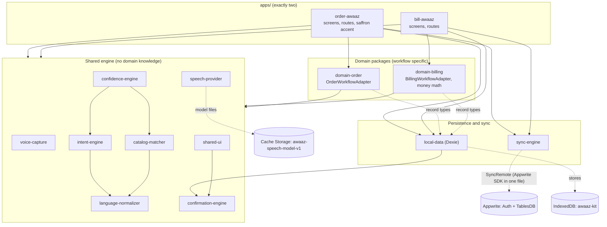
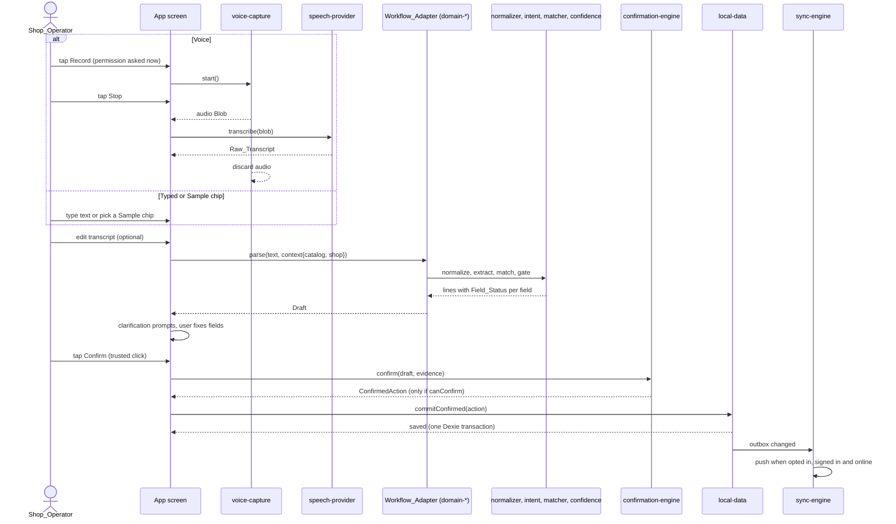
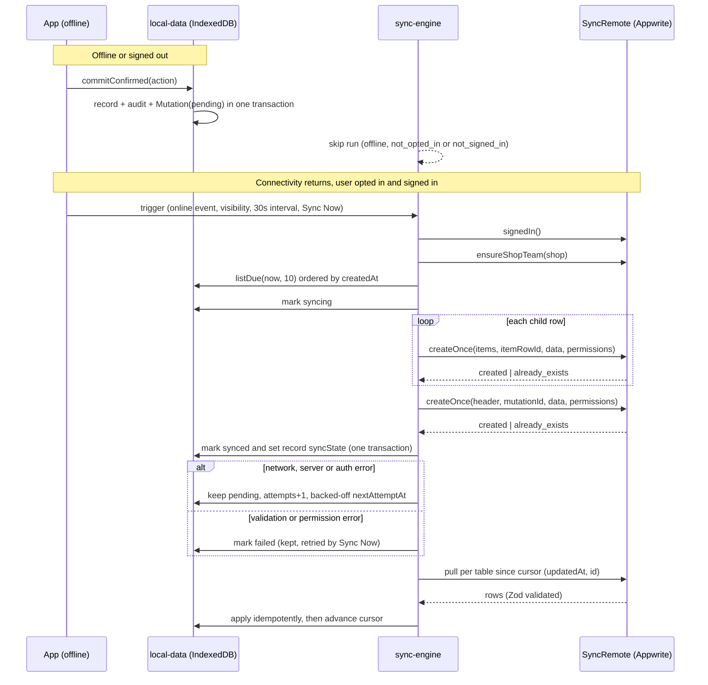

# Architecture

Awaaz Kit is a pnpm/TypeScript monorepo. One shared engine (12 packages under `packages/`) powers exactly two installable PWAs (`apps/order-awaaz`, `apps/bill-awaaz`). The normative source is `.kiro/specs/awaaz-kit/design.md`. This page describes the code as it is in the repo.

## 1. Layers

The engine knows nothing about orders or bills. Workflow-specific code lives in a `domain-*` package that implements the engine's `WorkflowAdapter` interface. That is what makes the reuse claim true by construction (Req 1.5).



Notes on how the repo differs from a naive reading of the layers:

- `sync-engine` imports no other workspace package. It talks to local data through the ports `SyncEngineStore`, `PushStore` and `PullStore`. `local-data` exports `createSyncStore(db)`, and each app's `SyncProvider.tsx` wires the two together. The apps are the only place where both meet.
- `confirmation-engine` has no workspace dependency. `local-data` and `shared-ui` import it for `ConfirmedAction`, `isConfirmedAction` and `createUserConfirmationEvidence`.
- `domain-*` packages import engine packages and `local-data` record types, never each other.

## 2. Dependency rules

`.dependency-cruiser.cjs` enforces these rules and `pnpm lint` fails on a violation. Update the rules and this table together.

| Package               | Role                                                                            | May import                                 | Must not import                                     |
| --------------------- | ------------------------------------------------------------------------------- | ------------------------------------------ | --------------------------------------------------- |
| `voice-capture`       | Mic capture, `Recording_State`                                                  | Browser APIs only                          | Any workspace package                               |
| `speech-provider`     | STT interface, `ModelManager`, providers (`scripted`, `shruti`, `whisper-wasm`) | Browser APIs, onnxruntime-web              | Domain packages, intent and catalog engines         |
| `language-normalizer` | Numbers, units, folding                                                         | Nothing in the workspace                   | Everything else                                     |
| `intent-engine`       | Item and slot extraction                                                        | Normalizer types                           | Domain, `local-data`, network                       |
| `catalog-matcher`     | Exact and fuzzy product match                                                   | Normalizer, Fuse.js                        | Domain, `local-data` (catalog is passed in as data) |
| `confidence-engine`   | `Field_Status`, clarification                                                   | Intent and matcher types                   | Domain, `local-data`                                |
| `confirmation-engine` | `WorkflowAdapter`, `ConfirmedAction`, `confirm`                                 | Confidence types                           | Domain, `local-data`                                |
| `local-data`          | Dexie schema, repositories, `commitConfirmed`, logger, seed                     | Dexie, confirmation-engine types           | Domain, React, `sync-engine`                        |
| `sync-engine`         | Outbox push and pull, `SyncRemote`, `AppwriteRemote`                            | `appwrite` SDK in one adapter file         | Domain, React                                       |
| `shared-ui`           | Shared React components, tokens                                                 | React, engine types                        | `local-data`                                        |
| `domain-order`        | `OrderWorkflowAdapter`, order drafts                                            | Engine packages, `local-data` record types | `domain-billing`, apps                              |
| `domain-billing`      | `BillingWorkflowAdapter`, money math                                            | Engine packages, `local-data` record types | `domain-order`, apps                                |

The cruiser rules by name:

| Rule                                                      | Meaning                                                                                               |
| --------------------------------------------------------- | ----------------------------------------------------------------------------------------------------- |
| `no-circular`                                             | No dependency cycles                                                                                  |
| `engine-not-to-domain`                                    | Engine packages never import `domain-*`                                                               |
| `voice-capture-isolated`                                  | `voice-capture` imports no other workspace package                                                    |
| `language-normalizer-isolated`                            | `language-normalizer` imports no other workspace package                                              |
| `engine-not-to-local-data`                                | `intent-engine`, `catalog-matcher`, `confidence-engine`, `confirmation-engine` take data as arguments |
| `shared-ui-not-to-local-data`                             | UI never touches persistence                                                                          |
| `local-data-not-to-sync-engine`                           | `local-data` does not import `sync-engine`                                                            |
| `local-data-and-sync-no-react`                            | Both are UI-free                                                                                      |
| `domain-not-to-domain` and `domain-not-to-domain-reverse` | Order and billing stay independent                                                                    |
| `packages-not-to-apps` and `apps-not-to-apps`             | Dependencies point toward packages only                                                               |

ESLint adds two rules: `no-restricted-imports` bans `dexie` in `apps/**` and `packages/shared-ui/**`, so apps reach data only through hooks over `local-data` repositories, and `no-console` is an error in production code (use the redacting logger from `local-data`).

## 3. Utterance pipeline

A spoken, typed or sample utterance only ever produces a draft. Nothing is written until the user confirms.



Guarantees the pipeline relies on:

- Audio stays in memory on the device and is discarded after transcription.
- Normalize, extract, match and gate are pure functions of their arguments (no I/O, clock or randomness).
- Only `confirm()` mints a `ConfirmedAction`, and only from a trusted click event. `commitConfirmed` rejects anything for which `isConfirmedAction()` is false.
- One transaction writes the record, its price snapshots, the audit event and the outbox Mutation. If it fails, no partial rows remain.

## 4. Offline-first sync

IndexedDB is the source of truth. The Outbox holds every Mutation until it is acknowledged. Sync runs only with opt-in, sign-in and connectivity. Until then Mutations stay pending and no business data leaves the device.



Key behaviours:

- Create-once entities (orders, bills and their items) use deterministic row ids derived from `mutationId` (UUIDv5 for items). A 409 maps to `already_exists` and counts as success, so retries create exactly one remote entity.
- Child rows are written before the header, so the header is the commit marker and a crash is completed by retry.
- Backoff is `min(5 min, 2 s * 2^attempts) * (1 - 0.2 * random())`, with `random` and `clock` injected.
- Products and customers use guarded upsert with last-write-wins on `clientUpdatedAt` and a `deviceId` tie-break. Finalized bills are never updated by pull.
- `rawTranscript` and `normalizedText` are sent only when "Sync transcripts" is on. It is off by default.
- Only `sync-engine/src/appwrite/appwrite-remote.ts` imports the `appwrite` SDK. Everything else uses the `SyncRemote` interface, and `InMemoryRemote` backs the tests.
- The client holds only `VITE_APPWRITE_ENDPOINT` and `VITE_APPWRITE_PROJECT_ID`. The API key is used only by `appwrite/setup.mjs`.

## 5. Build and hosting

```
https://<host>/         static hub page generated by scripts/build-hub.mjs
https://<host>/order/   Order Awaaz PWA (own manifest scope and service worker)
https://<host>/bill/    Bill Awaaz PWA (own manifest scope and service worker)
```

- `pnpm build` builds both apps, then assembles the combined `dist/` with the hub.
- On one origin, both apps share the IndexedDB database `awaaz-kit`, the catalog and the Speech_Model cache. During `pnpm dev:order` and `pnpm dev:bill` the ports differ, so the origins and databases are separate.
- Speech_Model files are excluded from precache and stored in Cache Storage (`awaaz-speech-model-v1`) after a user-initiated download. Voice works offline only after that download.
- A Dexie `versionchange` closes the connection and shows a "Reload to update" banner.

## 6. Reuse proof

[`docs/reuse-proof.md`](./reuse-proof.md) is generated by `pnpm reuse-report` from dependency-cruiser output. It shows that both apps reach all ten shared engine packages, directly or through their own domain package, and that `domain-order` and `domain-billing` are each reachable from one app only. Do not edit it by hand.

`examples/appointment-workflow/` shows a third workflow adapter built on the same engine without copying engine code. It is an example, not a third app.

## 7. Where to look

| Question                    | Location                                       |
| --------------------------- | ---------------------------------------------- |
| Requirements, design, tasks | `.kiro/specs/awaaz-kit/`                       |
| Dependency rules            | `.dependency-cruiser.cjs`, `eslint.config.js`  |
| Appwrite tables and setup   | `appwrite/appwrite.json`, `appwrite/setup.mjs` |
| Speech provider status      | `docs/model-benchmark.md`                      |
| Self-hosted test backend    | `docs/test-backend.md`                         |
| Kiro usage evidence         | `docs/kiro-journal.md`                         |
